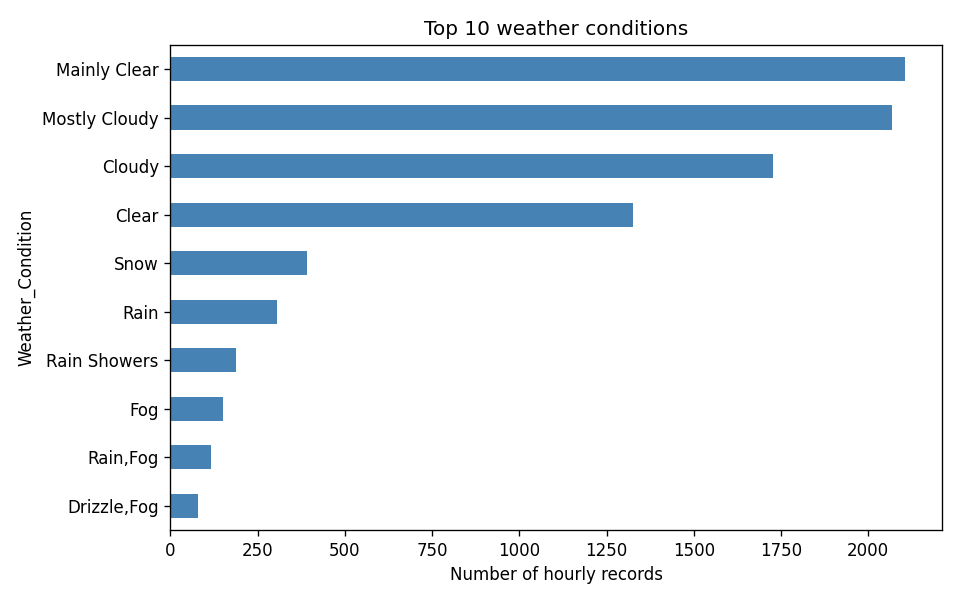
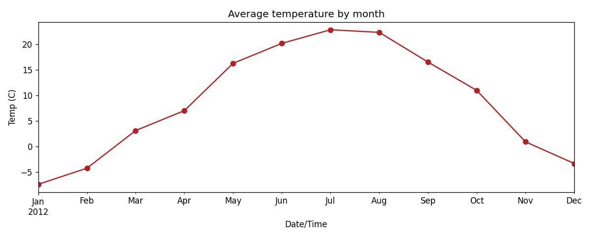

# Weather Data Analysis

Exploratory analysis of hourly weather data with pandas and matplotlib.

## Problem statement
Which weather conditions reduce visibility, how do wind, humidity and temperature change across the year, and when do snow and fog occur?

## Data
`filewether.csv` with columns: `Date/Time`, `Temp_C`, `Dew Point Temp_C`, `Rel Hum_%`, `Wind Speed_km/h`, `Visibility_km`, `Press_kPa`, `Weather`.

## What the notebook does
1. Inspects the data (shape, types, summary stats)
2. Cleans it (dates, duplicates, nulls, outlier check, season/month/hour columns)
3. Explores it with charts (conditions, distributions, temperature trend, correlation heatmap)
4. Answers 5 questions with `groupby` and filters

## Run it
```
pip install pandas matplotlib jupyter
jupyter notebook weather_analysis.ipynb
```
Put `filewether.csv` in the same folder as the notebook.

## Key findings
Fill these in after running on your data (see the last notebook cell), and add charts from the `images/` folder:




